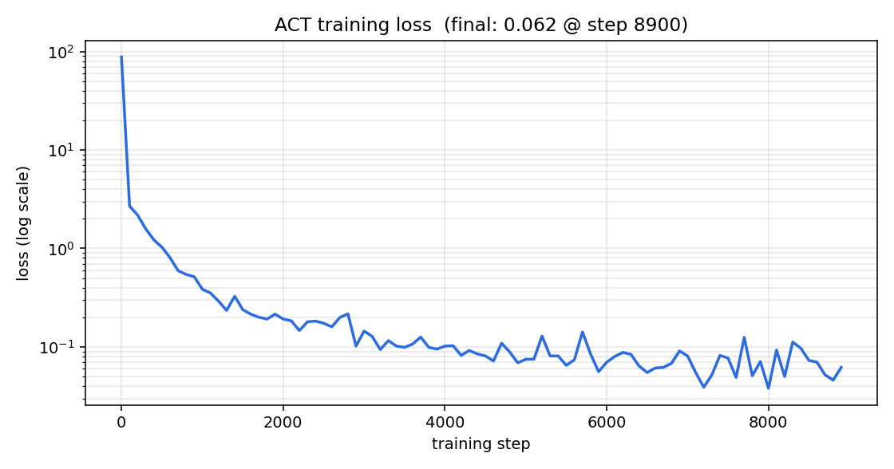

# 2個のブロックを集めるタスクの模倣学習

Physical AI 応用1 最終課題 / omnicampus: __ACCOUNT__

## 1. 課題の概要

ロボットアーム CRANE+ V2 が、机の左右に置かれた2個のブロックを順に押して、
中央の目標エリアへ集めるタスクを設定した。シミュレータは ROS 2 Humble + Gazebo
（Ignition Fortress）、制御方策は ACT（Action Chunking with Transformers）による
模倣学習で獲得した。

人がプログラムした軌道をそのまま再生するのではなく、**自動生成したデモ20エピソードから
方策を学習し、学習した方策が関節状態だけを見て2段構えの動作を再現する**ところまでを一連で行う。

| 項目 | 内容 |
|---|---|
| ロボット | CRANE+ V2（4自由度アーム＋グリッパ） |
| 対象物 | 4cm角のブロック2個（赤・青、各80g、摩擦係数0.45） |
| 開始位置 | 基部から半径0.14m・方位 −31.5°（赤）、+31.5°（青） |
| 目標エリア | 中央（方位0°）の 7.5cm × 13.5cm の矩形 |
| 成功判定 | 2個とも中心が目標エリアの矩形内 |
| AIの使用 | ACT による模倣学習（学習あり） |

## 2. 目的

講義（第4・5回）では、CRANE+ V2 に「お辞儀」をさせる模倣学習を体験した。
お辞儀は環境に働きかけない単一の動作であり、方策が多少ずれても結果は変わらない。
本課題では、**環境（物体）の状態を変える動作を2回つなげた多段タスク**に変更し、
一方を処理してから回り込んでもう一方を処理する、という手順の切り替えまで
関節状態だけを観測する方策が学習できるかを確かめることを目的とした。

## 3. システム構成

```
自動デモ生成 → rosbag2 記録 → LeRobotDataset 変換 → ACT 学習(GPU) → Gazeboで実行
```

すべて 1 つの Docker コンテナ（ROS 2 Humble + Gazebo + LeRobot）内で完結する。
実行環境は NVIDIA RTX 3060（12GB）／Windows 11 + Docker Desktop（WSL 2 backend）。

### 3.1 タスク環境

机と2個のブロック、横長の目標エリアを配置した専用ワールド `collect_task.sdf` を作成した。
ブロックは色と物理パラメータを明示した自前のモデルで、Gazebo Fuel への依存を減らしている。
MoveIt と RViz は本課題では不要なので起動しない構成とし、シミュレータを軽くしている。

### 3.2 動作の設計

CRANE+ V2 の URDF からリンク長（肩〜肘 0.083 m、肘〜手先 0.0935 m、基部〜肩 0.0714 m）を読み、
**平面2リンクの逆運動学**を実装した。手先位置を「作業半径 R・高さ H」で指定でき、
joint4 でグリッパを常に真下へ向ける。動作は次の5段階からなる。

1. 直立から、赤ブロック手前の上空（旋回 −0.80 rad、高さ0.195 m）へ移動し、天板すれすれ（0.142 m）まで下ろす
2. joint1 を −0.80 rad から −0.21 rad までゆっくり回し、赤を中央へ押す
3. 手先を持ち上げ、ブロックの上を越えて反対側（旋回 +0.95 rad）へ回り込み、再び下ろす
4. joint1 を +0.95 rad から +0.64 rad まで回し、青を中央へ押す
5. 手先を持ち上げ、目標エリアの上空で停止する

左右で押す向きが逆になる点に注意が必要だった。グリッパは joint4 の軸から見て横に 14.5 mm
ずれて付いているため、実際の接触点は joint1 の指令値より約 0.09 rad 手前側になる。
押す向きが反転すると、このずれは「ブロックの手前」ではなく「ブロックに重なる側」に働くため、
赤と青で開始・終了角を対称にすると青はブロックに乗り上げて内側へ弾いてしまう。
青側の回り込み角を 0.80 rad から 0.95 rad へ広げて解決した。

### 3.3 データ収集

`auto_demo_collect.py` が上記の軌道を生成し、講義のテレオペと同じトピック・同じ 20 Hz で
関節指令を出しながら rosbag2 に記録する。したがって出力は手集めのデータと同じ形式になり、
講義の変換・学習スクリプトをそのまま使える。エピソードごとに

- 赤の回り込み角 −0.84 〜 −0.76 rad / 押し終わり −0.25 〜 −0.17 rad
- 青の回り込み角 +0.91 〜 +0.99 rad / 押し終わり +0.60 〜 +0.68 rad
- 手先の高さ 0.140 〜 0.145 m
- 1個あたりの押し時間 2.7 〜 3.3 s

を乱数で変え、毎回2個のブロックを Gazebo の `set_pose` サービスで開始位置へ戻す。
記録後に両方の位置を読み、目標エリアの矩形に入っているかで成否を自動判定する。

収集結果: **20エピソード中 20 回成功**。

### 3.4 学習

LeRobotDataset へ変換（20エピソード × 360フレーム = 7200フレーム、20 Hz）したうえで、
ACT 方策を学習した。観測・行動はいずれも 5 次元（4関節＋グリッパ）で、画像は使っていない。

| 設定 | 講義デフォルト | 本課題 |
|---|---|---|
| training_steps | 200 | 9000 |
| batch_size | 2 | 16 |
| chunk_size | 16 | 32 |
| n_action_steps | 1 | 8 |
| action の delta_timestamps | −0.1〜1.4 s（16点） | 0〜1.55 s（32点） |

学習時間は RTX 3060 で約 15 分、最終損失は 0.046〜0.062 であった（損失曲線は図1）。



## 4. 結果

学習した方策を Gazebo 上で 10 回試行した。各試行の前にアームを直立へ戻し、
2個のブロックを開始位置へリセットして条件をそろえ、方策が指令を出し始めてから
26 秒間だけ制御させた。

| 試行 | 赤の最終位置 (x, y) [m] | 青の最終位置 (x, y) [m] | 判定 |
|---|---|---|---|
| 1 | (0.1272, −0.0152) | (0.1268, 0.0295) | 成功 |
| 2 | (0.1245, −0.0167) | (0.1268, 0.0300) | 成功 |
| 3 | (0.1257, −0.0119) | (0.1257, 0.0343) | 成功 |
| 4 | (0.1227, −0.0167) | (0.1273, 0.0297) | 成功 |
| 5 | (0.1260, −0.0123) | (0.1255, 0.0340) | 成功 |
| 6 | (0.1257, −0.0144) | (0.1266, 0.0315) | 成功 |
| 7 | (0.1253, −0.0138) | (0.1258, 0.0327) | 成功 |
| 8 | (0.1242, −0.0168) | (0.1271, 0.0292) | 成功 |
| 9 | (0.1263, −0.0142) | (0.1258, 0.0315) | 成功 |
| 10 | (0.1224, −0.0155) | (0.1255, 0.0308) | 成功 |

**成功率 10/10。** 目標エリアは 7.5 cm × 13.5 cm で、2個とも毎回その内側へ収まった。
10試行のばらつきは赤が y 方向 ±0.25 cm、青が ±0.26 cm と小さく、
方策はデモの平均的な軌道を安定して再現している。

## 5. 工夫した点と、つまずいて直したこと

- **多段タスクへの発展。** 講義のお辞儀デモは単一の動作だが、本課題では
  「押す → 回り込む → また押す」という手順の切り替えを含む。関節状態のみを観測する
  方策でも、状態が重複しないように軌道を設計すれば多段の手順を再現できることを確認した。

- **左右で非対称な接触点の補正。** 3.2 に書いたとおり、グリッパの取り付けオフセットにより
  押す向きを反転すると接触点のずれが逆向きに効く。最初は赤と青で対称な角度を使い、
  青がブロックに乗り上げて内側へ弾かれた。青側の回り込み角を広げて解決した。

- **指令を可動域内に丸めた。** グリッパを真下へ向ける姿勢を素直に逆運動学で解くと、
  移動中の joint4 の指令が可動域（−1.84 rad）を超える。超えた指令を出すと関節は端に
  張り付き、そこから戻るのに非常に時間がかかる。逆運動学の出力を可動域の内側
  （−1.78 rad）へ丸めることで、指令値と実際の姿勢が一致するようにした。

- **開始姿勢が実際に直立へ収束してから記録を始めるようにした（最も時間を要した点）。**
  最初の学習では、方策が直立から1個目を無視していきなり2個目の局面へ飛ぶという
  奇妙な失敗をした。オフライン評価では正しい行動を出すのに、実機（シミュレータ）では
  失敗する。原因は学習データ側にあった。デモ収集時、直立への指令を一定時間出すだけで
  次へ進んでいたため、端に張り付いた joint4 が戻りきらないまま記録が始まり、
  **全エピソードの先頭フレームが joint4 = −1.84 rad になっていた**。
  一方、推論時は十分な時間をかけて直立へ戻すので joint4 = 0 である。
  つまり方策にとって推論時の初期姿勢は学習データに無い状態であり、
  そこから出鱈目な行動が出ていた。`/joint_states` を購読して実測値が直立へ
  収束したことを確認してから記録を始めるよう直したところ、10試行すべて成功するようになった。
  学習が失敗したときに、方策そのものではなくデータの作り方を疑うべき典型例だったと考えている。

- **撮影を前提に環境を整えた。** 3Dビューだけを表示する GUI 設定とカメラ位置を用意し、
  コンテナ内の ffmpeg で画面録画から字幕付き動画の組み立てまでスクリプト化した。

## 6. 考察と今後の課題

本方策は関節状態のみを観測とするため、**ブロックの初期位置が変わると対応できない**。
今回はブロックを常に同じ位置へリセットしており、方策が学習しているのは事実上
「どの関節状態のとき次にどう動くか」という時系列の再現である。
2個を順に扱う手順の切り替えも、状態の重複がないように設計したから成立している。

実用性を考えるなら、カメラ画像を観測に加えた視覚条件付きの方策へ拡張し、
ブロックの位置や個数をランダム化したデータで学習する必要がある。CRANE+ のパッケージには
カメラ用の URDF と色検出のサンプルが含まれているため、同じパイプラインの延長で実装できる見込みである。

また、今回いちばん学びが大きかったのは、学習・推論それぞれは正しく動いていても
**両者が前提とする初期状態がずれているだけで方策が破綻する**という点である。
データ収集側の状態管理を検証可能にしておくこと（開始姿勢の収束判定、
データセット先頭フレームの確認）は、模倣学習を回すうえでの実務的な勘所だと感じた。

## 7. 提出物

- コード（GitHub）: __REPO_URL__
- 動画（YouTube）: __VIDEO_URL__
